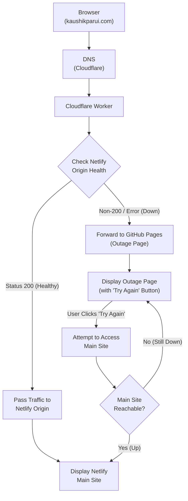

# kaushikparui.com – Website Status Fallback

This repository hosts the emergency fallback page for
**https://www.kaushikparui.com**

## Purpose
- Serve a clean, reliable outage page when the main site is unavailable
- Point visitors to the live incident report on the status page
- Let visitors retry the main site with one click

## How it works
1. The main site goes down.
2. A Cloudflare Worker detects the failure and serves this outage page instead.
3. Visitors can open the live incident report at **https://status.kaushikparui.com**.
4. Clicking **Try again** sends the visitor to **https://kaushikparui.com**.
   - If the site has recovered, they land on it normally.
   - If it is still down, the Cloudflare Worker serves this outage page again.

## Features
- 🎨 Modern, premium UI with a blended animated gradient background and glass-style card
- 🚨 Pulsing alert badge with expanding ripple rings
- 🌗 Light and dark themes, following the system preference, with a manual toggle (saved in `localStorage`)
- 🔗 **View live incident report** button linking to the status page
- 🔄 **Try again** button linking back to the main site
- 📱 Fully responsive, with stacked full-width buttons on small screens
- ♿ Accessible: focus states, ARIA labels, and reduced-motion support
- 🤖 Google-safe (`noindex, nofollow` meta tag + `robots.txt`) with the canonical URL pointing to the main site
- ⚡ No build step and no framework: plain HTML and CSS, with the logos preloaded

## Project structure
```
portfolio-outage/
├── CNAME                 # Custom domain for hosting (outage.kaushikparui.com)
├── README.md
├── robots.txt            # Keeps the outage page out of search results
├── index.html            # Outage page
├── styles/
│   └── outage.css        # Themes, background, card, buttons, animations
└── assets/
    ├── favicon/
    │   ├── favicon.ico
    │   ├── favicon-16x16.png
    │   └── favicon-32x32.png
    └── logo/
        ├── logo-ag-dark.webp
        └── logo-ag-light.webp
```

## Flowchart


## Status Source
Live service status and incident updates are published on the BetterStack
status page:

**https://status.kaushikparui.com**

## Customisation
- **Colours and themes:** edit the CSS variables under `:root[data-theme="dark"]` and `:root[data-theme="light"]` in `styles/outage.css`.
- **Copy:** edit the headline and text inside the `.card` in `index.html`.
- **Font:** the page loads Inter from Google Fonts. To avoid that external request, remove the three font `<link>` tags in `index.html` and the page falls back to the system font.